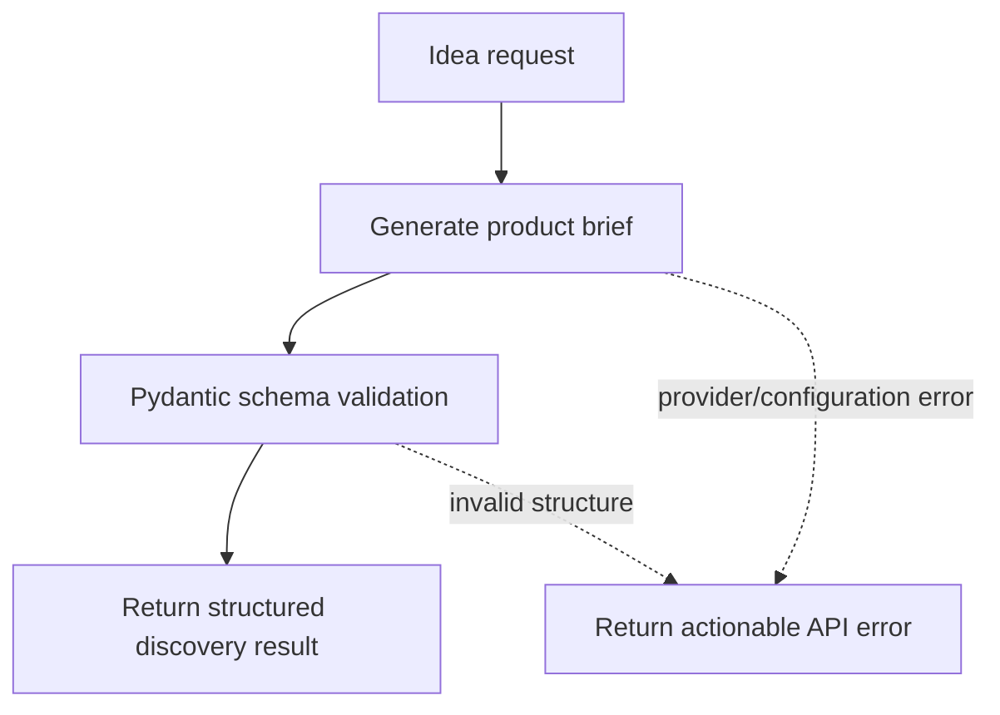

# Phase 2 — Product Manager Agent

## Objective
Replace the Phase 1 deterministic placeholder with a structured discovery workflow that turns a short idea into a reviewable product brief and prioritized backlog.

## Output contract
The agent returns a validated `ProductBrief` containing:

- Product name, tagline, vision, and problem statement.
- Target user groups and user personas (description, goals, frustrations).
- User pain points, desired outcomes, and business value.
- Success metrics.
- Explicit assumptions and material uncertainties.
- MVP scope, out-of-scope items, and future enhancements.
- Hierarchy: Epic → Capability → Feature → User Story → Acceptance Criteria.
- Brief status (`READY_FOR_REVIEW` for a generated first pass).

The schema is defined in `agent-service/app/schemas.py` and is exposed at `GET /v1/discovery/schema`.

## LangGraph workflow



### Node responsibilities

1. `generate_product_brief`: validates the incoming idea, selects the configured provider, requests a complete structured brief, and records provider/model metadata.
2. `validate_product_brief`: validates the generated JSON against the canonical Pydantic schema before returning it.

## LLM provider configuration

The agent supports a provider-independent OpenAI-compatible Chat Completions interface. The LangGraph workflow does not contain provider-specific code.

| Environment variable | Purpose |
|---|---|
| `LLM_PROVIDER` | `mock`, `openai-compatible`, `openai`, `gemini-compatible`, `groq-compatible`, or `custom` |
| `LLM_BASE_URL` | Provider API base URL, without `/chat/completions` |
| `LLM_MODEL` | Model identifier enabled for the account |
| `LLM_API_KEY` | Provider API key; do not commit it |

For Gemini's OpenAI-compatible endpoint, a typical configuration is:

```env
LLM_PROVIDER=gemini-compatible
LLM_BASE_URL=https://generativelanguage.googleapis.com/v1beta/openai
LLM_MODEL=gemini-2.5-flash
LLM_API_KEY=your-google-ai-studio-key
```

Confirm the currently available model ID and account limits with the provider before use. Other OpenAI-compatible providers can be configured by changing the base URL, model, and key.

### Demo mode

`LLM_PROVIDER=mock` is the default. It produces deterministic sample content so the full local workflow can be tested without an API key or API charges. The response contains a `DEMO_MODE` warning. It is not an LLM-generated analysis and must not be presented as validated market research.

When a real provider is selected but credentials are missing or the provider fails, the service returns an explicit error. It does not silently substitute demo content.

## API

### `POST /v1/discovery/run`

Request:

```json
{
  "idea": "Build a social photo-sharing platform for creators and communities",
  "product_name_hint": null,
  "context": {}
}
```

Response shape:

```json
{
  "product_brief": {
    "product_name": "...",
    "tagline": "...",
    "vision": "...",
    "problem_statement": "...",
    "target_users": [],
    "personas": [],
    "user_pain_points": [],
    "desired_outcomes": [],
    "business_value": [],
    "success_metrics": [],
    "assumptions": [],
    "uncertainties": [],
    "mvp_scope": [],
    "out_of_scope": [],
    "future_enhancements": [],
    "epics": [],
    "status": "READY_FOR_REVIEW"
  },
  "status": "COMPLETED",
  "provider": "mock",
  "model": "demo-product-manager",
  "warnings": ["DEMO_MODE: ..."]
}
```

### `GET /health`
Returns service health and phase number.

### `GET /v1/discovery/schema`
Returns the JSON Schema used to validate the canonical ProductBrief.

## Spring Boot integration

`POST /api/projects` now:

1. Creates a project row in PostgreSQL.
2. Creates an `agent_runs` record.
3. Calls the LangGraph discovery service.
4. Persists the validated brief in `projects.canonical_spec`.
5. Stores a `PRODUCT_BRIEF` artifact and agent-run output.
6. Moves the project to `PRD_READY` when successful.
7. Records `BLOCKED` / `FAILED` if the agent call fails.

`GET /api/projects` lists the latest projects for the development tenant. `GET /api/projects/{id}` returns the project and saved brief.

**Development-only identity:** this phase uses fixed development tenant/user UUIDs. Authentication and real tenant isolation must be implemented before multi-user or production use.

## Frontend changes

The dashboard now displays the generated product brief, target users, pain points, outcomes, business value, metrics, assumptions, uncertainties, MVP scope, epics, capabilities, features, user stories, and acceptance criteria. The provider/model and demo-mode warning are visible.

## Run locally

Start PostgreSQL from the repository root:

```bash
docker compose -f infra/docker-compose.yml up -d

PostgreSQL is exposed on localhost:5433 to avoid conflicts with a local PostgreSQL installation.
```

Agent service:

```bash
cd agent-service
uv sync
uv run uvicorn app.main:app --reload --port 8001
```

Spring Boot API (requires Java 21 and Maven):

```bash
cd backend
mvn spring-boot:run
```

Frontend:

```bash
cd frontend
npm install
npm run dev
```

Open `http://localhost:3000`. In demo mode, no LLM key is required. The PostgreSQL schema is loaded by the Docker entrypoint only when the database volume is first initialized. If an existing volume predates this schema, apply `infra/schema.sql` manually or create a fresh development volume after backing up any data.

## Phase 2 acceptance checklist

- [ ] Agent health endpoint returns `UP`.
- [ ] Mock discovery returns a schema-valid brief with at least one epic and testable acceptance criteria.
- [ ] Real provider mode fails clearly when API key/model configuration is missing.
- [ ] Real provider response is validated before being returned.
- [ ] Spring Boot stores project, agent run, and product brief artifact.
- [ ] Project detail endpoint returns persisted canonical specification.
- [ ] Frontend renders hierarchy and warnings without losing the project on refresh.
- [ ] Automated tests and local build checks pass in the developer environment.

## Known limitations

- The mock provider is illustrative, not semantic AI.
- This phase does not conduct live market research or validate business assumptions with real customers.
- No edit/approve workflow is persisted yet; the brief is currently marked `READY_FOR_REVIEW` to signal that user review is required.
- Fixed development identity is not secure multi-tenancy.
- No embedding generation or pgvector retrieval is needed for this first discovery pass; pgvector will be used when project context grows and semantic retrieval is justified.
- LLM providers differ in JSON mode support. The selected model must support the configured OpenAI-compatible endpoint and JSON response format.
