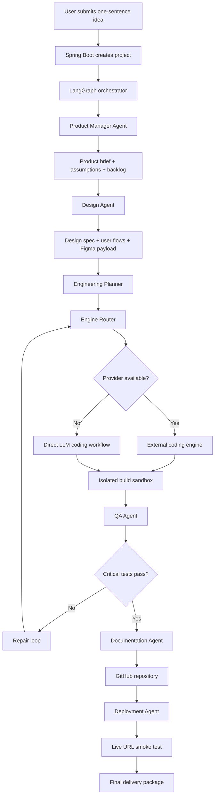

# Workflow and agent design

## Main workflow

## Agent responsibilities

### Orchestrator
Owns state transitions, retries, timeout policies, artifact references, approvals, and audit events. It does not make product decisions on behalf of specialist agents.

### Product Manager Agent
Produces a structured product brief, personas, pain points, desired outcomes, business value, assumptions, uncertainties, scope, epics, capabilities, features, user stories, and acceptance criteria.

### Design Agent
Produces user journeys, information architecture, screen inventory, design tokens, component specifications, responsive behavior, accessibility notes, and a Figma plugin payload.

### Engineering Planner
Selects a project profile and creates implementation tasks, architecture, database model, API contract, security requirements, and coding-engine requirements.

### Coding Agent / Engine Router
Chooses a connected engine based on capability, permissions, cost, and quality. All generated code is written to an isolated workspace.

### QA Agent
Runs static checks, unit/integration tests, API tests, and browser journeys. Maps test results to user-story acceptance criteria.

### Documentation Agent
Generates BRD, PRD, functional specification, technical architecture, API documentation, setup guide, known limitations, and release notes from canonical artifacts.

### Deployment Agent
Creates or updates a GitHub repository, configures build settings, deploys to the selected provider, waits for deployment, then performs a live smoke test.

## State machine
`IDEA_RECEIVED -> DISCOVERY -> PRD_READY -> DESIGN_READY -> IMPLEMENTATION_PLANNED -> GENERATING -> BUILDING -> QA -> DOCUMENTATION -> AWAITING_PUBLISH_APPROVAL -> DEPLOYING -> VERIFYING -> COMPLETED`

Failure states: `BLOCKED`, `FAILED`, `CANCELLED`. Retryable errors retain prior successful artifacts and record retry count.

## Approval gates
- User approves material product assumptions if they change scope or data handling.
- User authorizes external GitHub/Figma/Cloudflare accounts.
- User approves production deployment and custom-domain changes.
- Secret values are never included in prompts, generated source, logs, or client bundles.

## Cost controls
- Use inexpensive models for classification, extraction, and routine documentation.
- Use stronger models for architecture, complex code changes, and repair loops.
- Set token, wall-clock, retry, and provider spend budgets per project.
- Stop and request approval before exceeding configured budget.
